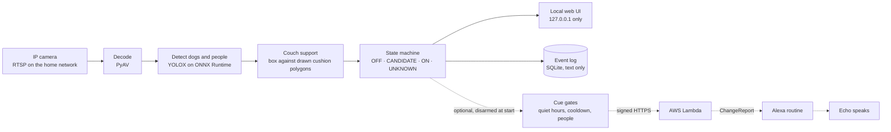

# Acacia Camera

[](https://github.com/neuroZ68/acacia-monitor/actions/workflows/tests.yml)


**Is the dog on the couch?** Acacia Camera watches a home IP camera on your own Mac and answers that question in a local web page, without sending video anywhere.

It reads the camera's RTSP stream, detects dogs and people with YOLOX, and decides whether a dog's body is actually supported by a couch cushion, as distinct from standing on the floor in front of it. It reports **OFF**, **CANDIDATE**, **ON**, or **UNKNOWN**, and it prefers UNKNOWN whenever the evidence is stale or unclear. It detects the dog class and does not identify Acacia individually. It aims for a low false-positive rate and does not promise zero errors.

Phase 1 only observes: there is no collar, stimulation, or actuation code. One optional addition makes an Echo speak when the dog is confirmed on the couch. It is off by default and disarmed at every start.

## How it works



A confident dog detection says nothing about the couch, so classification is separate from detection. Each frame's dog box is measured against cushion polygons that you draw on the live view, and the state machine needs that evidence to persist before it confirms ON or OFF. Stale video, a lost stream, a person blocking the cushions, or a view that no longer matches the calibration all lead to UNKNOWN instead of a guess. [docs/STATE_MACHINE.md](docs/STATE_MACHINE.md) has the full transition table.

## Status

Results are recorded in [docs/RESULTS.md](docs/RESULTS.md), which separates what was measured on the real camera from bench measurements and from work that is still pending.

| Area | Status |
|---|---|
| Live detection on the real camera | Running, with cushions drawn on the live view; **no accuracy figure yet** |
| First supplied clip | 1 of 2 couch visits confirmed, with no false event |
| Failure handling (stale video, reconnects, bad credentials, stop) | Tested on the bench |
| Voice cue on Alexa+ | Working: a confirmed ON fires a routine that speaks on a chosen Echo |
| Recorded voice clip through a custom skill | Built and deployed; works only on original Alexa, because Alexa+ refuses unapproved custom skills |
| Intel MacBook Pro | Planned; continuous integration installs and tests on an Intel runner |

## Highlights

- **Local by design.** The interface binds to `127.0.0.1` and refuses unexpected Host and Origin headers. Audio is never set up, and no image or video is ever written to disk.
- **Couch support, not just detection.** A dog in front of the couch and a dog on the cushions are different answers.
- **Honest uncertainty.** UNKNOWN is a first-class state, and the last known state is shown with its age as history, not as a current claim.
- **Credentials stay out of files.** Camera credentials live in the macOS Keychain, are redacted from logs and errors, and a built-in scan checks the repository for secrets.
- **Calibrate in the browser.** Draw, drag, and disable cushion polygons on the live view, and calibration invalidates itself when the rotation, stream, or aspect ratio changes.
- **Measure before trusting.** Replay a saved clip, mark ground truth in the Validate tab, and score the result against it.
- **Optional Alexa cue.** Gated by quiet hours, a cooldown, a daily limit, and recent people in view, with a cloud-side rate limit as a backstop. See [alexa/README.md](alexa/README.md).

## Quick start

You need macOS 13 or later and Python 3.12 or 3.13. Setup creates a virtual environment, installs the pinned dependencies, creates `config.toml`, and downloads and verifies the model.

```bash
git clone https://github.com/neuroZ68/acacia-monitor.git
```

```bash
cd acacia-monitor && ./setup.sh
```

Set `camera.host` in `config.toml`, store the camera account at a hidden prompt, and start the app:

```bash
./acacia credentials set
```

```bash
./acacia run
```

Open <http://127.0.0.1:8765>, then draw the cushions in the Cushions tab. Nothing is classified until they exist.

## Documentation

| Document | Contents |
|---|---|
| [docs/ARCHITECTURE.md](docs/ARCHITECTURE.md) | Decision record, licences, Intel constraints |
| [docs/STATE_MACHINE.md](docs/STATE_MACHINE.md) | Evidence rules and the transition table |
| [docs/VALIDATION.md](docs/VALIDATION.md) | Test protocol and scoring rules |
| [docs/RESULTS.md](docs/RESULTS.md) | Measured and pending results |
| [docs/MIGRATION.md](docs/MIGRATION.md) | Moving to the Intel MacBook Pro |
| [alexa/README.md](alexa/README.md) | Setting up and testing the optional voice cue |

## Repository layout

```
src/acacia/     application: ingest, detector, classifier, state machine, web UI, cue
alexa/          AWS Lambda, CloudFormation template, and skill setup for the voice cue
tests/          deterministic tests plus RTSP integration tests
tools/          camera simulator and the Intel wheel check
docs/           architecture, state machine, validation, results, migration
```

---

The rest of this page is the operating guide.

## Setup

`./setup.sh` is safe to re-run, and it preserves `config.toml`, `data/`, and `models/`. After it finishes, set `camera.host` in `config.toml` to the camera's current address. DHCP may change it, so a router reservation helps. Keep UPnP off. No port forwarding or cloud subscription is needed.

## Credentials

Camera credentials are entered at a hidden local prompt and stored in the macOS Keychain, so they stay out of source files, shell history, and command-line arguments. Use the camera account created in the camera's app (for a Tapo camera, the Camera Account in the Tapo app), and never paste it into a chat.

```bash
./acacia credentials set
```

```bash
./acacia credentials status
```

To use a file instead of the Keychain, set `credentials.backend = "file"` and create a gitignored `secrets.local.toml` containing `username` and `password` keys. The application refuses to read the file unless it is owner-only, so run `chmod 600 secrets.local.toml`.

If a camera credential is ever exposed, for example in a screenshot, change the camera account in the camera's app and run `./acacia credentials set` again.

## Start and stop

```bash
./acacia run
```

Open <http://127.0.0.1:8765>. Stop with Ctrl-C, or from another terminal:

```bash
./acacia stop
```

`./acacia status` prints the current state and health without opening a browser.

## Calibrating the cushions

Calibration must be done against the current live view, and nothing is classified until it exists. Open the Cushions tab and choose **Edit cushions**, then **Add polygon**. Click around the seat surface a dog would rest on, and click the first corner or press Enter to finish. Add one polygon per cushion section if that is easier to fit, then choose **Save**. Selecting a polygon lets you drag its corners, drag a small dot to add a corner, and Shift-click a corner to remove it. The checkbox disables a polygon without deleting it.

Draw the seat surface only, and leave out the front face of the couch. That front face separates seat from floor in the image, and the geometry depends on it. Leave out the back cushions as well unless a dog resting there should count as ON.

Polygons are stored in normalized coordinates with the view they were drawn on. A changed rotation, stream, or aspect ratio invalidates them automatically, and a size-only change does not. **Automatic camera-movement detection is not implemented.** If the camera is bumped or moved, press **Camera moved** and redraw; until then the calibration indicator cannot know the view has changed.

## Reading the interface

The header shows the state and the reason for it, with chips for stream, calibration, and detector health. In UNKNOWN, a last-known state may appear with its age; this is history and not a current claim. Grey boxes marked "not classified" are detections with no classification behind them, for example before calibration, and they show what the model sees without saying anything about the couch. The Evidence tab shows detector confidence and couch support separately, because a confident detection of a dog says nothing about whether it is on a cushion.

The Events tab separates **confirmed** events, **raw** candidates, and **system** events. The Validate tab records ground truth for scoring, and the Health tab shows these diagnostics.

| Metric | Meaning |
|---|---|
| Decoded fps, Inference fps | Rates over the last 10 seconds |
| Frames overwritten | Decoded frames replaced before inference used them; this is expected and shows the buffer staying bounded |
| Stale frames skipped | Frames too old to be worth running |
| Frame age at inference | Local age only. Sensor capture time is not available |
| Inference | Model run time, excluding preprocessing |
| Decode to decision | Frame decoded to state updated. Excludes camera buffering |
| Decision to UI ack | State updated to browser confirming the draw, including the return trip |
| Backlog | How far the latest frame lags the stream's own timeline |

## Configuration

`config.example.toml` documents every setting. The values marked below can also be changed in the Settings tab, which applies them at once and stores them in `data/settings.local.json`. All defaults are hypotheses to validate.

| Setting | Meaning | Settings tab |
|---|---|---|
| `camera.host`, `port`, `path` | Where the stream is | No |
| `camera.transport` | `tcp` or `udp` | No |
| `camera.rotation_deg` | Rotation applied before calibration | No |
| `camera.auth_max_attempts` | Failed logins before waiting for Retry | No |
| `detector.model`, `provider` | Model and runtime provider | No |
| `detector.inference_interval_s` | Inference cadence | Yes |
| `detector.min_confidence` | Boxes below this are discarded | Yes |
| `detector.dog_confidence` | Minimum for a dog to count as ON evidence | Yes |
| `detector.person_confidence` | Minimum for a person box | Yes |
| `classifier.on_support` | Couch support needed for ON evidence | Yes |
| `classifier.ambiguous_support` | Support at or above this is AMBIGUOUS | Yes |
| `classifier.min_visible_fraction` | Cushion visibility needed to call a frame clear | Yes |
| `state.on_confirm_s`, `clear_confirm_s` | ON and OFF confirmation intervals | Yes |
| `state.lost_clear_s` | Clear interval when a dog vanished without an observed exit | Yes |
| `state.stale_timeout_s` | Age at which video counts as stale | Yes |
| `retention.max_events`, `max_age_days` | Metadata limits | Yes |

## Privacy

The interface binds to `127.0.0.1`, and the application refuses any other address because phase 1 has no authentication. Requests with an unexpected Host or Origin are rejected, so a website open in the same browser cannot read the camera feed. Audio is never set up on the stream. Images and video are never written to disk, and no capture feature exists. `./acacia replay` reads a clip you already have and writes nothing.

The `data/` folder holds only text: events, ground-truth marks, resource samples, calibration, settings, and a rotating log capped at about 20 MB. Metadata is pruned to the limits in `[retention]`. Credentials are redacted from logs, errors, health output, and crash output, which matters because the video library includes the full URL in its own error messages. A camera SD card's recording settings are separate from this application and unnecessary for it.

At runtime the only connections are one RTSP stream to the camera and the loopback interface. Installation needs the internet for PyPI and GitHub, and normal operation does not. The optional cue is the one exception: when armed, it sends a small signed request with no image or audio in it to your own AWS function.

## Troubleshooting

| Symptom | Likely cause and action |
|---|---|
| "No camera credentials stored" | Run `./acacia credentials set`, then **Reconnect now** in the Health tab |
| "Camera rejected the credentials" | Retries stop after 3 to avoid a lockout. Fix them with `./acacia credentials set`, then press **Reconnect now** |
| "Camera refused the connection" or timeouts | Check `camera.host`, since DHCP may have moved the camera; confirm the camera is on in its app |
| "Camera has no such stream path" | Check `camera.path`. `/stream1` and `/stream2` both work on a Tapo camera |
| State stays UNKNOWN with "Draw cushion polygons" | No calibration yet |
| "Calibration invalid" | The view changed, or Camera moved was pressed. Redraw and save |
| "Detector failed to load" | Run `./acacia model fetch`. A checksum failure means the file was damaged |
| Inference fps below the target | Compare the Inference timing with `detector.inference_interval_s`, and try `./acacia bench` |
| Video looks delayed | Compare frame age with the delay method in `docs/VALIDATION.md`; camera buffering is not visible locally |
| "Already running" | Run `./acacia stop`. A stale PID file is cleaned up automatically |
| Port 8765 in use | Change `server.port` |

Logs are in `data/acacia.log`, already sanitized.

## Measuring and testing

```bash
./acacia probe --seconds 15
```

```bash
./acacia bench
```

To run a saved clip through the detector, and through the classifier and state machine once polygons exist:

```bash
./acacia replay path/to/clip.mp4
```

The test suite uses synthetic geometry and timing, with no private images.

```bash
.venv/bin/python -m pip install -r requirements-dev.txt
```

```bash
.venv/bin/python -m pytest -m "not integration"
```

The integration tests need `ffmpeg` and `mediamtx` on `PATH`, and they run real libav against a local RTSP server.

```bash
.venv/bin/python -m pytest -m integration
```

`tools/sim_camera.py` provides a stand-in camera for checking the interface without hardware. It proves nothing about real accuracy.

Before committing, scan for secrets. The scan reports file and line only.

```bash
./acacia check-secrets
```

## Installed components and uninstall

Everything the application needs lives inside this folder, with the exception of the Keychain items. The integration tests and the simulator also use `mediamtx`, installed through Homebrew.

To remove the application, stop it and delete its Keychain items, then delete the folder, which contains `.venv/`, `models/` (about 100 MB for the default model), and `data/`:

```bash
./acacia stop
```

```bash
./acacia credentials delete
```

If you deployed the voice cue, delete the CloudFormation stack and the two skills as well; see [alexa/README.md](alexa/README.md).

To remove the test server as well:

```bash
brew uninstall mediamtx
```
